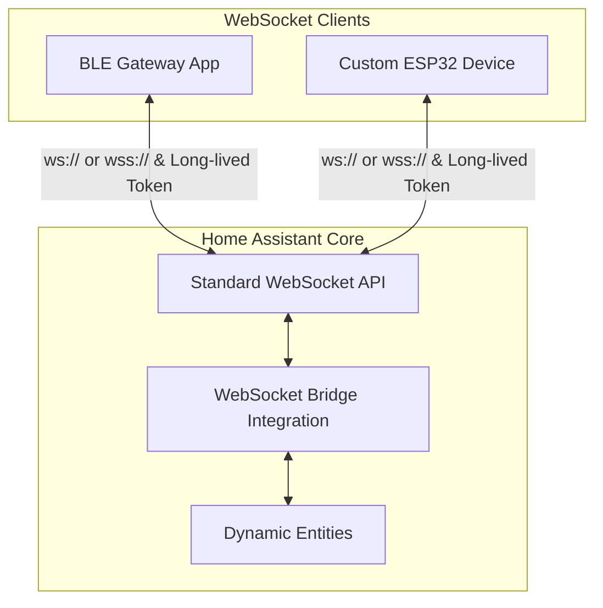

# Reference: Architecture, Platforms, Protocol Summary

> Detailed reference moved out of the README. Content is preserved unchanged.

## 📐 Architecture Flow

## 🛠️ Supported Entity Platforms

| Platform | Direction | Description / Supported Attributes |
|:---|:---:|:---|
| `sensor` | Read | Numerical state data (`unit_of_measurement`, `device_class`, `state_class`) |
| `binary_sensor` | Read | On/Off boolean states (`device_class`) |
| `switch` | Control | Power toggle control (`turn_on`, `turn_off`) |
| `number` | Control | Range value control (`set_value`, `min`, `max`, `step`) |
| `select` | Control | Option selection control (`select_option`, `options`) |
| `button` | Control | Execution trigger (`press`, stateless) |
| `update` | Control | Firmware update (`install` / `check`; `installed_version` / `latest_version`) |
| `light` | Control | Brightness / color (`turn_on` / `turn_off` with `params`) |
| `cover` | Control | Open/close/position/tilt (`open_cover`, `set_cover_position`, …) |
| `fan` | Control | Speed / preset / oscillate / direction |
| `text` | Control | Writable string (`set_value`; not `text_sensor`) |
| `lock` | Control | `lock` / `unlock` / `open` |
| `date` / `time` / `datetime` | Control | ISO string + `set_value` |
| `event` | Read | `event_types` required (not restored on restart) |
| `valve` | Control | Open/close/position |
| `climate` | Control | HVAC mode / temp / humidity / fan / swing |
| `humidifier` | Control | Humidity / mode |
| `water_heater` | Control | Temp / operation / away |
| `siren` | Control | `turn_on` / `turn_off` (+ tone/volume) |
| `alarm_control_panel` | Control | arm/disarm/trigger |
| `media_player` | Control | Playback / volume / source (v1) |
| `image` | Read | URL image |
| `camera` | Control | Still/stream URL |

Planned (not accepted on the wire yet): `vacuum` / `lawn_mower` / `remote` / `todo`. See [PROTOCOL.md §6](PROTOCOL.md#6-planned-platforms).

## 📄 Protocol Specification

For the detailed JSON message formats exchanged between clients and the bridge, see:
- **[English Protocol Specification (docs/PROTOCOL.md)](PROTOCOL.md)**
- **[Korean Protocol Specification (docs/PROTOCOL_ko.md)](PROTOCOL_ko.md)**

### Message Summary:
* **Session Registration**: `{"type": "ws_bridge/connect", "gateway_id": "..."}`
* **Entity Declaration**: `{"type": "ws_bridge/entity", "unique_id": "...", "platform": "sensor", ...}`
* **State Update**: `{"type": "ws_bridge/state", "states": [{"unique_id": "...", "value": 25.4}]}`
* **Device Availability**: `{"type": "ws_bridge/availability", "device_id": "...", "online": true}`
* **Remove**: `{"type": "ws_bridge/remove", "unique_id": "..."}` / `{"device_id": "..."}` / `{}` (entire gateway)
* **Sync**: `{"type": "ws_bridge/sync", "unique_ids": [...]}` — removes entities of this gateway that are absent from the list, leaving the rest (and their history) untouched
* **Control Event**: HA pushes `{"kind": "command", "unique_id": "...", "action": "turn_on"}` events to the client.
