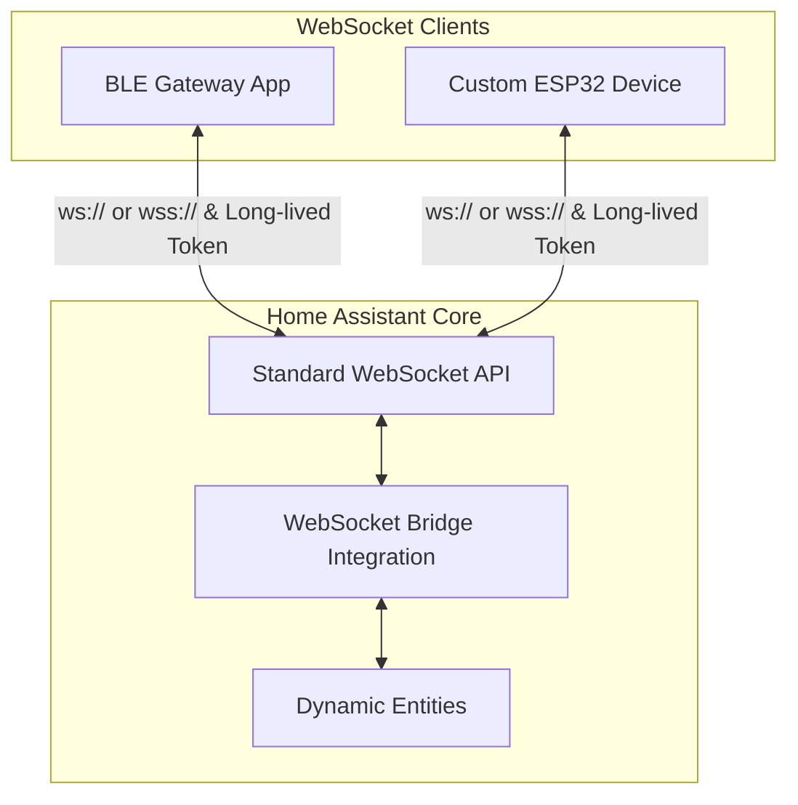

# 레퍼런스: 아키텍처·플랫폼·프로토콜 요약

> README에서 분리한 상세 참조입니다. 원문 내용을 보존했고, 메시지 순서 안내는 README와 [PROTOCOL_ko.md](PROTOCOL_ko.md)에 있습니다.

## 📐 아키텍처

## 🛠️ 지원 엔티티 플랫폼

| 플랫폼 | 방향 | 설명 / 지원 속성 |
|:---|:---:|:---|
| `sensor` | 읽기 | 수치 상태 (`unit_of_measurement`, `device_class`, `state_class`) |
| `binary_sensor` | 읽기 | On/Off 불리언 상태 (`device_class`) |
| `switch` | 제어 | 전원 토글 (`turn_on`, `turn_off`) |
| `number` | 제어 | 범위 값 제어 (`set_value`, `min`, `max`, `step`) |
| `select` | 제어 | 옵션 선택 (`select_option`, `options`) |
| `button` | 제어 | 실행 트리거 (`press`, 상태 없음) |
| `update` | 제어 | 펌웨어 업데이트 (`install` / `check`, `installed_version` / `latest_version`) |
| `light` | 제어 | 밝기/색상 (`turn_on` / `turn_off`, `params`) |
| `cover` | 제어 | 개폐/위치/틸트 (`open_cover`, `set_cover_position`, …) |
| `fan` | 제어 | 속도/프리셋/진동/방향 |
| `text` | 제어 | 쓰기 가능 문자열 (`set_value`; `text_sensor`와 다름) |
| `lock` | 제어 | `lock` / `unlock` / `open` |
| `date` / `time` / `datetime` | 제어 | ISO 문자열 + `set_value` |
| `event` | 읽기 | `event_types` 필수 (재시작 시 복원 안 함) |
| `valve` | 제어 | 개폐/위치 |
| `climate` | 제어 | HVAC 모드/온도/습도/팬/스윙 |
| `humidifier` | 제어 | 습도/모드 |
| `water_heater` | 제어 | 온도/운전모드/외출 |
| `siren` | 제어 | `turn_on` / `turn_off` (+ tone/volume) |
| `alarm_control_panel` | 제어 | arm/disarm/trigger |
| `media_player` | 제어 | 재생/볼륨/소스 (1차) |
| `image` | 읽기 | URL 이미지 |
| `camera` | 제어 | still/stream URL |

예정 (와이어에서 아직 거절됨): `vacuum` / `lawn_mower` / `remote` / `todo`. [PROTOCOL_ko.md §6](PROTOCOL_ko.md#6-예정-플랫폼) 참고.

## 📄 프로토콜 규격

클라이언트와 브릿지 간 JSON 메시지 형식은 아래 문서를 참고하세요.
- **[영문 프로토콜 규격 (docs/PROTOCOL.md)](PROTOCOL.md)**
- **[한글 프로토콜 규격 (docs/PROTOCOL_ko.md)](PROTOCOL_ko.md)**

### 메시지 요약
* **세션 등록**: `{"type": "ws_bridge/connect", "gateway_id": "..."}`
* **엔티티 선언**: `{"type": "ws_bridge/entity", "unique_id": "...", "platform": "sensor", ...}`
* **상태 갱신**: `{"type": "ws_bridge/state", "states": [{"unique_id": "...", "value": 25.4}]}`
* **장치 가용성**: `{"type": "ws_bridge/availability", "device_id": "...", "online": true}`
* **삭제**: `{"type": "ws_bridge/remove", "unique_id": "..."}` / `{"device_id": "..."}` / `{}` (게이트웨이 전체)
* **동기화**: `{"type": "ws_bridge/sync", "unique_ids": [...]}` — 목록에 없는 이 게이트웨이의 엔티티만 제거하고, 나머지는 히스토리까지 그대로 유지
* **제어 이벤트**: HA가 클라이언트에 `{"kind": "command", "unique_id": "...", "action": "turn_on"}` 형태로 push합니다.
